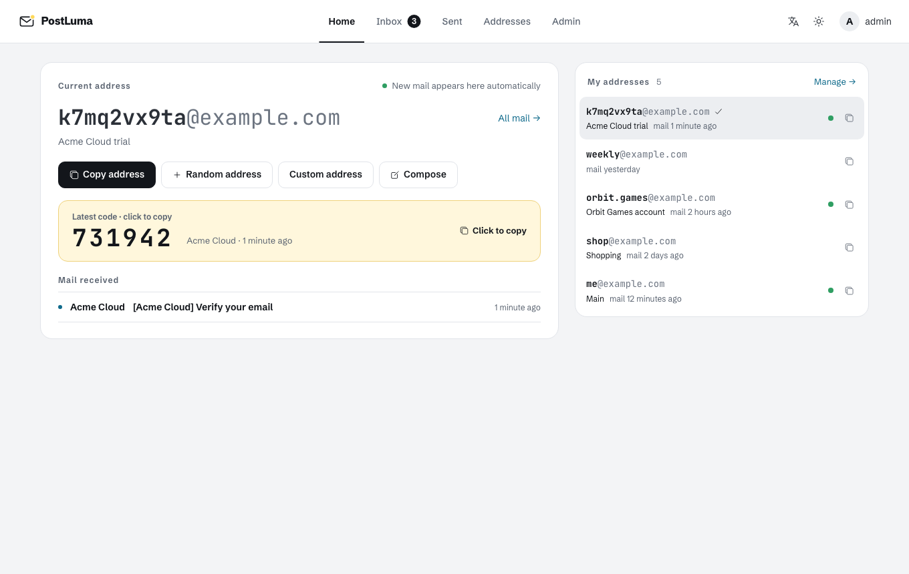
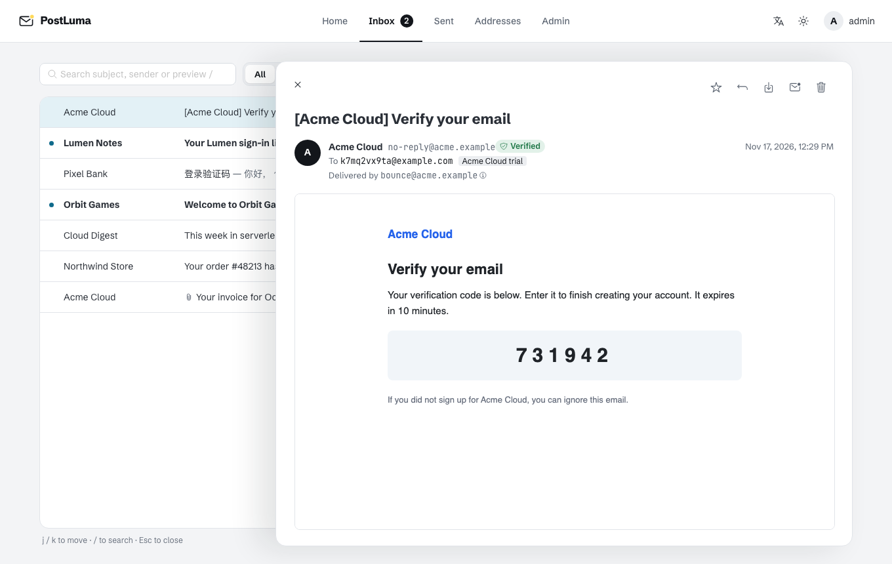
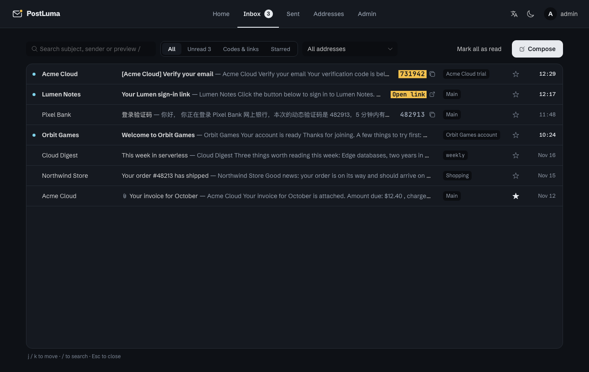
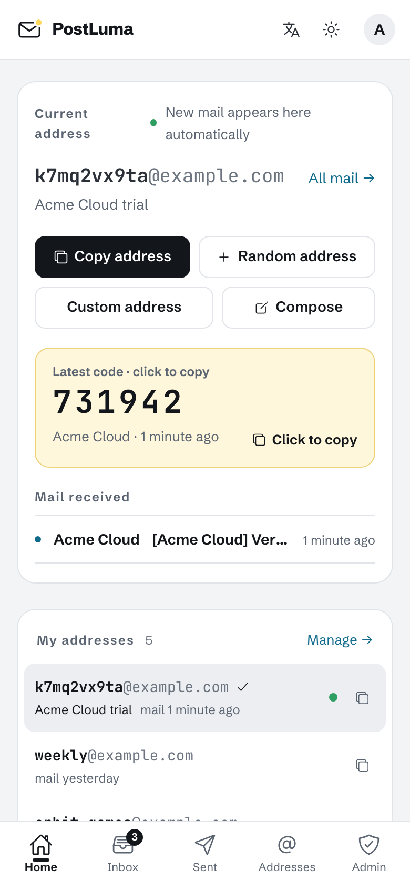
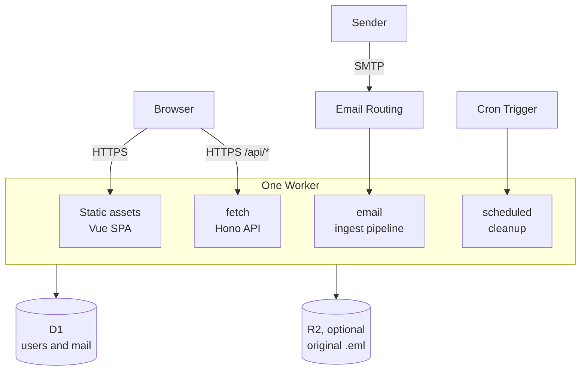

<p align="center">
  
</p>

<h1 align="center">PostLuma</h1>

<p align="center">
  A mailbox that runs on Cloudflare. No server, and the Free plan is enough.<br>
  Use it as your own inbox, or as a temporary-mail service for a few friends.
</p>

<p align="center">
  <a href="https://deploy.workers.cloudflare.com/?url=https://github.com/ZeyuZuo/postluma"></a>
</p>

<p align="center"><a href="README.md">简体中文</a> · <b>English</b></p>

| Home: current address, latest code and all addresses | Inbox: an opened message slides in from the right |
|---|---|
|  |  |
| **Dark theme** | **Phone** |
|  |  |

## Why

I wanted a mailbox I could keep for years. Mostly it signs me up to websites and catches verification codes, and now and then I answer a message. I did not want a server for that: OS patches, nginx and certificates all need someone watching them.

Cloudflare already has the pieces. Email Routing receives mail, Workers runs the code and D1 stores it, and for one person the free allowances are plenty. PostLuma puts them together, and my own mail runs on it.

## What using it looks like

Click "Random address" on the home page. The address is created and already on your clipboard. Use it to sign up somewhere, and the verification mail shows up right under the address with the code highlighted in amber; one click copies it. You never leave the page or reload it.

Pick a mode at deploy time with `SERVICE_MODE`:

| | Personal `personal` | Temporary `temporary` |
|---|---|---|
| Who uses it | Only the administrator, which is you | Several users, each approved by the administrator |
| Sign-up and user management | None | Yes; sign-up can be closed |
| Addresses | Unlimited, including ones like `me@` and `contact@` | A quota; 3 to 32 characters; reserved names not allowed |
| Starred mail, kept past retention | Yes | No |
| Catch-all: the first message to a new address creates it | Yes, per domain | No |
| Sending | Yes, off by default | No |
| Random addresses, codes, verification links, cleanup, originals in R2 | Yes | Yes |

## Features

Receiving
- Random or custom addresses; a new address is copied and becomes the "current address" on the home page
- New mail appears without a reload: every 10 seconds for 10 minutes after you create an address, every 30 seconds otherwise
- Verification codes are detected (Chinese, English and Japanese keywords; years, prices, phone and order numbers are left out) and copied with one click
- "Verify your email" and sign-in links are detected (https only) and open in a new tab with one click
- Per-address `+tags`: mail to `name+shop@` lands in `name@`
- Several receiving domains

Reading
- HTML mail is shown in a sandbox that cannot run scripts; remote images stay off until you click "Load images"
- Originals are kept in R2, so you can download attachments, see inline images, read the full body and download the `.eml`
- Filter the inbox by unread or by codes and links, filter by address, search, and move with `j` / `k`
- Sender authentication hints: "Verified" or "Suspicious sender", from the SPF, DKIM and DMARC results Cloudflare records on arrival

Personal mode
- Starred mail and its original in R2 are never cleaned up automatically, up to 500 messages
- Catch-all: switch it on for a domain and the first message to a new address creates that address, tagged "Auto-created". At most 10 new addresses a day, and auto-created addresses together use at most half of the daily receiving budget, so however much spam arrives, real mail still gets through
- Sending is off by default. Switched on, you can write and reply from your own addresses, plain text only, through Resend: 20 messages per person and 100 for the whole service each day

Temporary mode
- Open sign-up with administrator approval; ban, unban, or close sign-up
- A per-user address quota, a cap on total addresses and on new addresses per day

Admin and interface
- Manage receiving domains and check that their MX records point at Cloudflare Email Routing
- Settings, usage stats and an activity log
- Mail is kept for 30 days by default and then deleted
- Top navigation on desktop, a bottom tab bar on phones; light and dark themes; English and Simplified Chinese

## How it works



- The Free plan gives each invocation 10 ms of CPU, so only the first 256 KB of a message is parsed on arrival. The result goes to D1 for listing, search and code detection, while the full original streams to R2. Attachments are decoded by the browser when you open them, never by the Worker.
- Database writes are budgeted the same way: a message costs about 7 writes, receiving stops at 5,000 messages a day and deletions have a daily cap too, so together they cannot use up D1's 100,000 free writes per day.
- Every query that runs per request or per poll uses an index, and query-plan tests keep it that way. For exact quotas, check Cloudflare's current documentation.

## Deploying

Before you start, you need:

- A Cloudflare account and a domain on Cloudflare. Email Routing only works for such domains.
- A GitHub or GitLab account to hold your copy of the code.
- R2 switched on. R2 asks for a payment method before first use; within the free allowance (10 GB of storage a month) nothing is charged. To skip R2, see the manual deployment below.

### 1. Create a Turnstile widget

The sign-in page uses Turnstile against password guessing. In the Cloudflare dashboard, open Turnstile and add a widget:

- For the hostname, enter the domain you will open PostLuma at. On `workers.dev` that is `<your-subdomain>.workers.dev`; the Workers overview page shows your subdomain. A hostname also covers everything below it. If you add a custom domain later, add it to the widget as well.
- Note the site key and the secret key.

### 2. Deploy with the button

[](https://deploy.workers.cloudflare.com/?url=https://github.com/ZeyuZuo/postluma)

No fork needed. Cloudflare creates a new repository in your account, copies this code into it, creates the D1 database and the R2 bucket, and asks for three values. All three are required:

| Name | Value |
|---|---|
| `ADMIN_INITIAL_PASSWORD` | Initial password for the administrator `admin`; only used for the first sign-in |
| `TURNSTILE_SITE_KEY` | The site key from step 1 |
| `TURNSTILE_SECRET_KEY` | The secret key from step 1 |

It then builds, creates the database tables and deploys. From then on, every push to your copy of the repository deploys again.

### 3. Route mail to PostLuma

In the dashboard, open your domain, go to Email → Email Routing and enable it; it adds the MX records for you. Then, under Routing rules, set the Catch-all action to Send to a Worker and choose `postluma`.

Catch-all only hands mail to PostLuma; PostLuma decides what to accept. Mail to an address that does not exist or is disabled bounces.

### 4. Sign in

Open the Worker's address, for example `https://postluma.<your-subdomain>.workers.dev`. The username is `admin` and the password is the `ADMIN_INITIAL_PASSWORD` from step 2.

Then:

1. Click your avatar in the top right, open Account settings and change the password.
2. In the Cloudflare dashboard, delete `ADMIN_INITIAL_PASSWORD` under the Worker's Settings → Variables and Secrets. The administrator is created only once, so it is never needed again.
3. In Admin → Mail domains, add the domain from step 3.

You can receive mail now.

### Personal or temporary

The button deploys personal mode, where only the administrator signs in. To let others sign up, set `SERVICE_MODE` to `temporary` in `wrangler.jsonc` in your copy of the repository, then commit and push. Switching modes leaves the data alone, and you can switch back at any time.

### Updating

The repository the button creates is a separate copy, not a fork, so it does not follow this one. To update, merge this repository's main into it:

```bash
git remote add upstream https://github.com/ZeyuZuo/postluma.git
```

```bash
git pull upstream main --allow-unrelated-histories
```

The copy may share no commit history with this repository, hence the flag on the first merge. If there are conflicts, keep your own `database_id` and any variables you changed in `wrangler.jsonc`, then push. Cloudflare deploys it and applies any new database migrations.

If you plan to follow updates closely, you can instead fork this repository and deploy your fork by hand (below), connecting it in the dashboard. Updating is then the Sync fork button on GitHub.

<details>
<summary>Deploying by hand instead</summary>

You need Node.js `^22.18` or `>=24.12`.

1. Get the code:

   ```bash
   git clone https://github.com/ZeyuZuo/postluma.git && cd postluma && npm install
   ```

2. Choose `SERVICE_MODE` in `wrangler.jsonc`.
3. Create the D1 database and put the `database_id` it prints into `wrangler.jsonc`, replacing the value there:

   ```bash
   npx wrangler d1 create postluma
   ```

4. Create the R2 bucket. To do without R2, delete the `r2_buckets` block in `wrangler.jsonc` instead: only the parsed mail is kept then, without attachment downloads, inline images or full originals.

   ```bash
   npx wrangler r2 bucket create postluma-mail
   ```

5. Create a Turnstile widget as in step 1 above.
6. Deploy, then set the three secrets:

   ```bash
   npm run deploy
   ```

   ```bash
   npx wrangler secret put ADMIN_INITIAL_PASSWORD
   ```

   ```bash
   npx wrangler secret put TURNSTILE_SITE_KEY
   ```

   ```bash
   npx wrangler secret put TURNSTILE_SECRET_KEY
   ```

   Or connect the repository in the dashboard (Workers & Pages → Create → Import a repository) with the build command `npm run build` and the deploy command `npx wrangler d1 migrations apply DB --remote && npx wrangler deploy`; every push then deploys.

7. Route mail and sign in as in steps 3 and 4 above.

Older versions took the site key from the build variable `VITE_TURNSTILE_SITE_KEY`. That still works; when `TURNSTILE_SITE_KEY` is set, it wins.

</details>

<details>
<summary>Switching on sending (personal mode)</summary>

1. Add and verify your sending domain at [Resend](https://resend.com). Add the DKIM and SPF records it shows to your Cloudflare DNS; they usually sit under a `send.` subdomain and do not touch the MX records used for receiving.
2. Create an API key at Resend and run `npx wrangler secret put RESEND_API_KEY`, or add it under the Worker's Variables and Secrets.
3. In PostLuma, go to Admin → Settings → Sending, turn on "Allow sending (service-wide)" and send a test message. Then, in Mail domains, turn on "Can send" for the domains you want to send from.

Each message can have up to 5 recipients. Each person can send 20 messages a day and the whole service 100, which is the daily limit of Resend's free plan.

</details>

Catch-all needs no extra setup: in Admin → Mail domains, turn on "Catch-all: create addresses" for a domain. How many addresses it may create a day, and how much mail each may receive per hour, are under Settings.

## Configuration

Everything you can tune is in `vars` in `wrangler.jsonc`, each with a comment and an allowed range. Out-of-range values fall back to the default with a warning in the logs. Commit and push to apply a change. Do not edit these variables in the Cloudflare dashboard: the next deployment overwrites them with the values in the file.

<details>
<summary>All variables</summary>

| Variable | Value in this repository | Meaning |
|---|---|---|
| `SERVICE_MODE` | `personal` | `personal` or `temporary`; missing or invalid means `temporary` |
| `REGISTRATION_OPEN` | `true` | Whether temporary mode takes sign-ups; the administrator can override it |
| `DEFAULT_MAILBOX_QUOTA` | `10` | Active addresses per user in temporary mode; adjustable per user |
| `MAX_TOTAL_MAILBOXES` / `MAX_DAILY_MAILBOX_CREATIONS` | `100` / `30` | Addresses in total, disabled ones included, and new addresses per 24 hours |
| `INGEST_MAX_PER_MAILBOX_PER_HOUR` / `INGEST_MAX_PER_USER_PER_HOUR` | `10` / `100` | Flood limits; administrators are exempt |
| `INGEST_MAX_MESSAGES_PER_DAY` / `INGEST_MAX_MB_PER_DAY` | `5000` / `12` | Daily receiving budget for the whole service |
| `RAW_MAIL_MAX_MB_PER_DAY` | `250` | Originals written to R2 per day; `0` keeps no originals |
| `MESSAGE_RETENTION_DAYS` | `30` | Days mail is kept; the administrator can override it within the database's capacity |
| `MAX_DELETES_PER_DAY` | `5000` | Daily cap shared by scheduled cleanup and bulk deletions |
| `MAX_STARRED_MESSAGES` | `500` | Starred messages per person |
| `CATCH_ALL_MAX_PER_DAY` / `CATCH_ALL_MAX_PER_ADDRESS_PER_HOUR` | `10` / `10` | Addresses catch-all may create per day, and messages per auto-created address per hour; both can be overridden in the admin |
| `SENDER_AUTH_HINTS` | `true` | Show sender authentication results |
| `PASSWORD_PBKDF2_ITERATIONS` | `20000` | A trade-off for the Free plan's CPU limit; raise it on a paid plan |
| `SENDING_ENABLED` | `false` | Default of the service-wide sending switch; the administrator can override it |
| `MAIL_PROVIDER` | `resend` | Sending provider; `log` only records messages, for local development |
| `SEND_MAX_PER_USER_PER_DAY` / `SEND_MAX_PER_DAY` | `20` / `100` | Sending limits per person and for the whole service, per 24 hours |
| `SEND_MAX_RECIPIENTS` | `5` | Recipients per message |

</details>

## Security

- Isolation between users: every address and mail query carries `user_id` in its SQL. Someone else's resource answers 404, the same as one that does not exist, so ids cannot be probed. Every endpoint has a cross-user test.
- Mail is filed by the envelope recipient only: the address record that exactly matches the recipient decides who gets a message. No header is trusted and nothing is matched loosely.
- Addresses are never reused: they can be disabled but not deleted, and a deleted user's addresses go into a permanent reserved list, so nobody receives the previous owner's codes or password resets.
- Administrators cannot read mail: admin endpoints return counts only, never mail content or users' addresses.
- Sign-in: PBKDF2 password hashes, an HttpOnly cookie backed by a database session that can be revoked at any time, Turnstile and per-IP rate limits on sign-in and sign-up, and a same-origin `Origin` check on every write.
- Attachments always download as `application/octet-stream`; mail content is never rendered on the site's own origin.

## Non-goals

- Not a full mail client: no folders, IMAP/SMTP, contacts, HTML composing or attachments in outgoing mail.
- No sending in temporary mode, so the domain cannot be used for spam that would hurt its own deliverability.
- Addresses are not deleted. Disabled addresses keep their history and can be enabled again; old mail goes with the retention period.
- Administrators cannot read users' mail. This is a design decision, not a missing feature.

## Troubleshooting

- **The sign-in button stays disabled, or sign-in says verification failed**: check that `TURNSTILE_SITE_KEY` and `TURNSTILE_SECRET_KEY` come from the same widget and are not swapped, and that the widget's hostnames include the domain you open PostLuma at (Turnstile reports error 110200 otherwise).
- **Deployment says "Please enable R2 through the Cloudflare Dashboard"**: R2 is not switched on for the account. Switch it on and deploy again, or deploy by hand without `r2_buckets`.
- **Mail to an address bounces**: check that the address is active and that the domain's Catch-all points at `postluma`; in temporary mode, also that the user has been approved.
- **Error 1102 when signing in**: the Worker went over the Free plan's CPU time; lower `PASSWORD_PBKDF2_ITERATIONS`.

## Local development

```bash
cp .dev.vars.local.example .dev.vars    # local secrets, Turnstile off
npm run db:migrate:local                # set up the local D1
npm run dev                             # front end, API and mail handler in one server
```

Simulate incoming mail (write `+` as `%2B`):

```bash
curl -X POST --data-binary @mail.eml "http://localhost:5173/cdn-cgi/handler/email?from=a@example.org&to=name@your.domain"
```

Tests:

```bash
npm test             # Vitest inside workerd: API, mail handling, cross-user isolation, query plans
npm run test:e2e     # Playwright: safe HTML rendering, main flows, phone-width layout
npm run type-check
```

The browser tests start one dev server per mode, each on its own throwaway data, so your local data is untouched. Run `npx playwright install chromium` before the first run.

If `npm install` says the install scripts of workerd or esbuild were blocked (npm 12 blocks them by default), run `npm install-scripts approve workerd esbuild && npm rebuild workerd esbuild`. If local queries fail with `no such table`, run `npm run db:migrate:local` again.

Layout: `worker/` is the Worker (API, mail handler, scheduled jobs and all SQL), `src/` the Vue front end, `shared/` the types and validation both use, `migrations/` the database migrations, and `test/` and `e2e/` the tests. Conventions are in [CLAUDE.md](CLAUDE.md); requirements and decisions are in [docs/](docs/) (in Chinese).

## License

Copyright (C) 2026 Zeyu Zuo

PostLuma is open source under the [GNU AGPL-3.0](LICENSE):

- Anyone may use, deploy, modify and share it for free, commercially too.
- If you distribute a modified version, it must use AGPL-3.0 as well, and whoever receives it must be able to get the complete source.
- If you run a modified version as a website or service, you must offer its source to the people using it.

It comes with no warranty. Third-party packages and fonts keep their own licenses.
