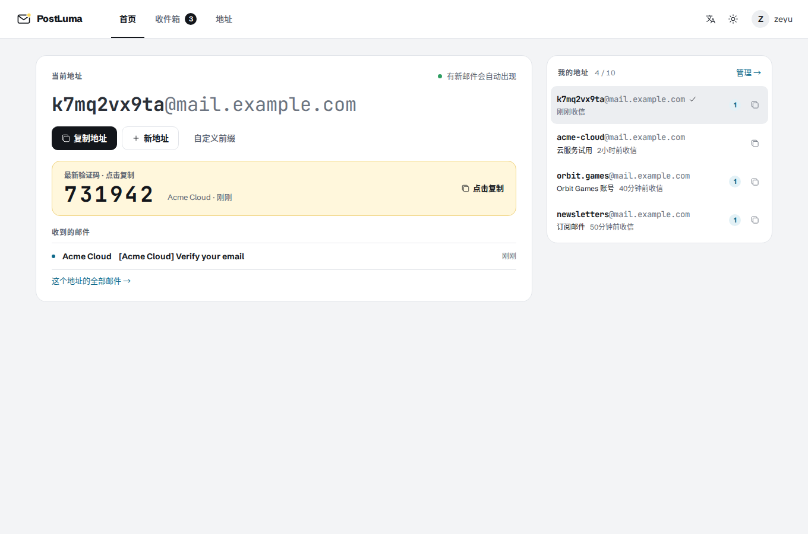
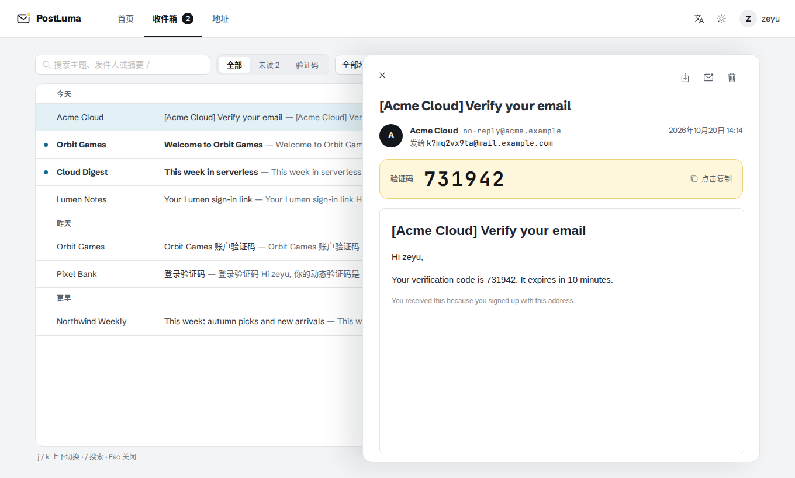
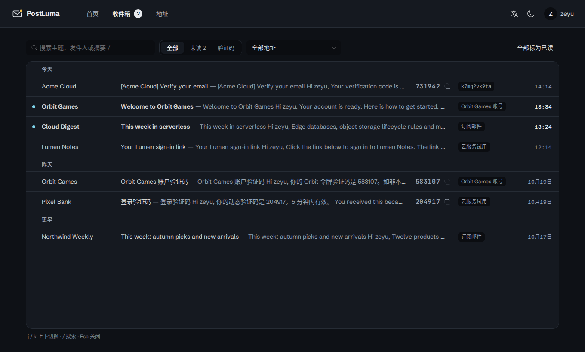
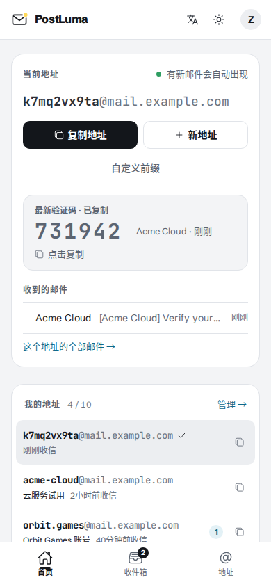

<p align="center">
  
</p>

<h1 align="center">PostLuma</h1>

<p align="center">
  A multi-user temporary mailbox on Cloudflare: create an address → receive the code → copy it.<br>
  Workers + Email Routing + D1 (+ optional R2). Runs on the Free plan, no server needed.
</p>

<p align="center"><a href="README.md">简体中文</a> · <b>English</b></p>

---

| Home: current address, latest code and all addresses | Inbox: one line per message, details slide in |
|---|---|
|  |  |
| **Dark theme** | **Phone** |
|  |  |

*Screenshots show the Chinese interface; English is built in and selectable at any time.*

## What it is

PostLuma is a private temporary mailbox for you and people you trust, built for signing up to websites and receiving verification codes. Click “New address” on the home page: a random address is created, copied to your clipboard and becomes your current address. Mail sent to it appears right below it, the verification code is detected and highlighted in amber, and one click copies it — no page switching.

What sets it apart from other Cloudflare mail projects is that **isolation between users** comes first: each user sees only their own mail, admins can't read anyone's mail, and an address that was ever handed out is never given to anyone else.

## Features

**Receiving and codes**
- Generate a random address or choose a prefix; a new address is copied and becomes the current one
- You decide the current address: the one you last created, copied or picked stays current across reloads; the list beside it shows each address's note, unread count and any code not copied yet
- For 10 minutes after creating an address the app checks for mail every 10 s (otherwise every 30 s); new mail shows up without a reload
- Verification codes are detected (Chinese, English and Japanese keywords; years, amounts, phone and order numbers excluded) and copied in one click; copying marks the message read, so amber only highlights codes not copied yet
- Per-address opt-in `+alias`: mail to `name+shop@domain` also reaches `name@domain`, without using quota
- Multiple receiving domains, managed by admins

**Reading mail**
- HTML mail is rendered through three layers: DOMPurify, a CSP inside the mail document and a script-less iframe sandbox; remote images are blocked by default to stop tracking
- Original messages are kept in R2 (optional): download attachments, see inline images, read bodies beyond the parse window, download the `.eml`
- Inbox filters (All / Unread / Codes), per-address filter, search and keyboard navigation (`j` / `k`, `/` to search, `Esc` to close)

**Users and administration**
- Open sign-up with admin approval (sign-up can be closed); approve, reject, ban, unban — bans take effect immediately
- Per-user address quota, total cap and daily creation cap
- Admin panel: users, receiving domains, settings, usage statistics, audit log
- Mail retention (30 days by default) with a daily cleanup job; all bulk deletions share a daily budget so they can't exhaust the Free plan's writes

**Interface**
- Vue 3 + Naive UI; top navigation on desktop, bottom tab bar on phones
- Light and dark themes; Simplified Chinese and English — a new language is one locale file

## Security model

- **Tenant isolation**: every mailbox and message query filters on `user_id` in SQL; someone else's resource returns 404, exactly like a missing one, so ids can't be probed. Every endpoint has a "user B requests user A's resource" test.
- **Ownership comes from the envelope recipient only**: mail is assigned by exact match of the recipient address, never from headers; no fuzzy matching.
- **Addresses are never reused**: addresses can be disabled but not deleted; when a user is deleted their addresses are reserved forever, so a new owner can never receive the previous owner's codes or password resets.
- **Admins can't read mail**: admin endpoints return aggregate numbers only, never message content or users' addresses.
- **Authentication**: PBKDF2 password hashes, HttpOnly cookie + database sessions (revocable), Turnstile + per-IP rate limits on sign-in and sign-up, same-origin `Origin` check on every write.
- **Attachments** are always downloaded as `application/octet-stream`; no mail content is ever rendered on the app's origin.

## Non-goals

- **No sending.** Receive-only, which avoids abuse and domain-reputation problems.
- **No address deletion.** Disabled addresses keep their history and can be re-enabled; old mail is removed by the retention job.
- **Admins can't view users' mail.** A product decision, not a to-do.

## Architecture

```
                    ┌──────────────────────── one Worker ────────────────────────┐
 Browser ──HTTPS──▶ │ static assets (Vue SPA)                                     │
                    │ fetch     → Hono API  /api/*   ──▶ D1 (users, addresses,    │
 Sender ──SMTP──▶   │ email     → ingest pipeline          mail)                  │
 Email Routing      │                                ──▶ R2 (original .eml, opt.) │
                    │ scheduled → cleanup (retention, expired sessions)           │
                    └─────────────────────────────────────────────────────────────┘
```

- Only the first 256 KB of a message is parsed on delivery (the Free plan allows 10 ms CPU per invocation). The parsed copy goes to D1 for listing, search and code detection; the full original is streamed to R2 at the same time. The Worker never decodes attachments — the browser parses the original when needed.
- A delivery costs about 7 D1 row writes; every per-request or polling query is index-bounded, guarded by query-plan regression tests.
- Designed for the Cloudflare **Free plan** (10 ms CPU per invocation, roughly 100k D1 row writes per day, 500 MB per database, 10 GB of R2); ingest volume, deletions and retention all have tunable limits. Check Cloudflare's current documentation for exact quotas.

## Deployment

**Prerequisites**: a Cloudflare account; receiving domains on Cloudflare DNS (required by Email Routing); Node.js `^22.18` or `>=24.12`.

1. **Get the code and install dependencies**

   ```bash
   git clone https://github.com/ZeyuZuo/postluma.git && cd postluma
   npm install
   ```

2. **Create the D1 database** and put the printed `database_id` into `wrangler.jsonc` (replacing the existing value):

   ```bash
   npx wrangler d1 create postluma
   ```

3. **(Optional) Create the R2 bucket** for original messages and attachments. Enabling R2 requires a payment method on the account; usage within the free tier is not charged. If you don't want it, remove `r2_buckets` from `wrangler.jsonc` and only the parsed content is stored.

   ```bash
   npx wrangler r2 bucket create postluma-mail
   ```

4. **Create a Turnstile widget** (Cloudflare dashboard → Turnstile) with your site's hostname.
   - Site Key (public) → build variable `VITE_TURNSTILE_SITE_KEY`
   - Secret Key (private) → Worker secret `TURNSTILE_SECRET_KEY`
   - Don't swap them: the build fails if the site key looks like a secret key.

5. **Deploy**, either way:
   - **Workers Builds (recommended)**: dashboard → Workers & Pages → Create → Import a repository. Project name `postluma` (must match `wrangler.jsonc#name`); build command `npm run build`; deploy command `npx wrangler d1 migrations apply DB --remote && npx wrangler deploy`; add the build variable `VITE_TURNSTILE_SITE_KEY`. Every push deploys.
   - **From your machine**: put `VITE_TURNSTILE_SITE_KEY` in `.env.production.local`, then run `npm run deploy`.

   Then set the secrets:

   ```bash
   npx wrangler secret put ADMIN_INITIAL_PASSWORD
   npx wrangler secret put TURNSTILE_SECRET_KEY
   ```

6. **Route mail**: for each receiving domain, open Email → Email Routing, enable it and add **Catch-all → Send to a Worker → postluma**. The catch-all only forwards; PostLuma decides what to accept and bounces unknown or disabled addresses.

7. **First sign-in**: username `admin`, password `ADMIN_INITIAL_PASSWORD`. Change the password right away, then delete that secret (the admin account is created only once). Add the domains from step 6 under "Receiving domains" in the admin panel, and start approving sign-ups.

## Configuration

Tunables live in `wrangler.jsonc#vars`, each with a comment and an allowed range; out-of-range values fall back to the default with a warning in the logs. Edit the file and redeploy — values changed in the dashboard are overwritten by the next deploy.

| Variable | Default | Meaning |
|---|---|---|
| `REGISTRATION_OPEN` | `true` | Allow sign-up requests (admins can override) |
| `DEFAULT_MAILBOX_QUOTA` | `10` | Active addresses per user (adjustable per user) |
| `MAX_TOTAL_MAILBOXES` / `MAX_DAILY_MAILBOX_CREATIONS` | `100` / `30` | Total addresses incl. disabled, and new ones per 24 h |
| `INGEST_MAX_PER_MAILBOX_PER_HOUR` / `INGEST_MAX_PER_USER_PER_HOUR` | `10` / `100` | Flood limits (admins exempt) |
| `INGEST_MAX_MESSAGES_PER_DAY` / `INGEST_MAX_MB_PER_DAY` | `5000` / `12` | Service-wide daily intake |
| `RAW_MAIL_MAX_MB_PER_DAY` | `250` | Daily R2 budget for originals; `0` keeps none |
| `MESSAGE_RETENTION_DAYS` | `30` | Mail retention (admins can override within storage limits) |
| `MAX_DELETES_PER_DAY` | `5000` | Daily budget shared by cleanup and bulk deletions |
| `PASSWORD_PBKDF2_ITERATIONS` | `20000` | A Free-plan CPU trade-off; raise it on a paid plan |

## Local development

```bash
cp .dev.vars.example .dev.vars          # local secrets (Turnstile off)
npm run db:migrate:local                # set up the local D1
npm run dev                             # Vite + workerd: UI, API and inbound mail in one server
```

Simulate inbound mail (write `+` as `%2B`):

```bash
curl -X POST --data-binary @mail.eml \
  "http://localhost:5173/cdn-cgi/handler/email?from=a@example.org&to=name@your.domain"
```

## Tests

```bash
npm test             # Vitest inside workerd: API, ingest, cross-tenant matrix, query plans
npm run test:e2e     # Playwright: hostile HTML rendering, main flows, phone layouts
npm run type-check
```

Browser tests run on their own throwaway state (`.wrangler/e2e`) and never touch your dev data; run `npx playwright install chromium` once first.

## Repository layout

```
worker/        Cloudflare Worker: API routes, inbound mail, cron, all SQL (repo/)
src/           Vue 3 front end
shared/        Types, validation and error codes shared by both sides
migrations/    D1 migrations
test/          Vitest (workerd) tests; cross-tenant tests in test/isolation/
e2e/           Playwright browser tests
docs/          Product requirements, roadmap, decision log (Chinese)
```

## Documentation

- [Product requirements (PRD)](docs/PRD.md) — Chinese
- [Roadmap](docs/DEV_PLAN.md) — Chinese
- [Open questions and decisions](docs/QUESTIONS.md) — Chinese
- [Code conventions and architecture](CLAUDE.md) — English, for contributors

## Troubleshooting

- **`npm install` says the workerd / esbuild install scripts were blocked**: npm 12 blocks install scripts by default. Run `npm install-scripts approve workerd esbuild && npm rebuild workerd esbuild`.
- **Local queries fail with `no such table`**: after changing `database_id`, run `npm run db:migrate:local` again.
- **Sign-in fails with error 1102 (CPU limit)**: lower `PASSWORD_PBKDF2_ITERATIONS`.
- **Mail to an address bounces**: check that the address is in use, its owner is approved, and the domain has the catch-all rule.
