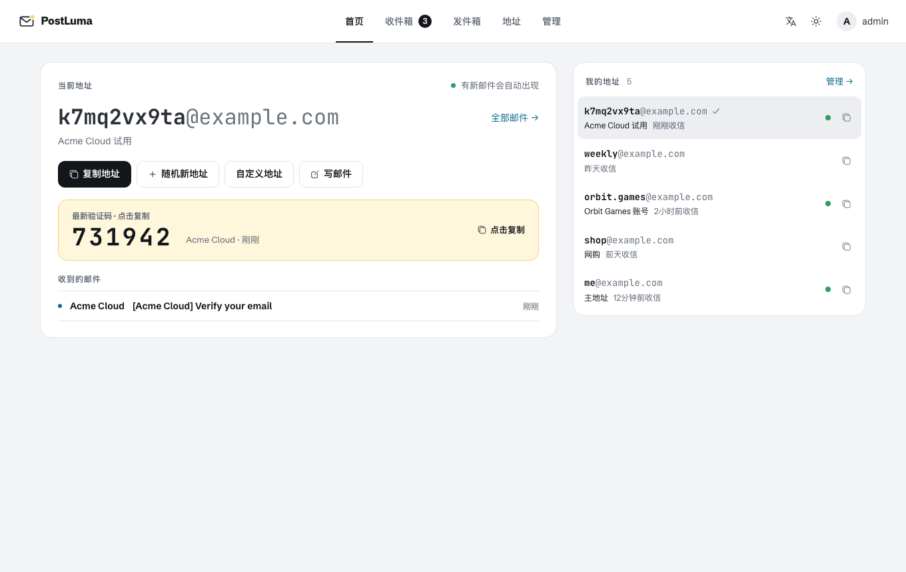
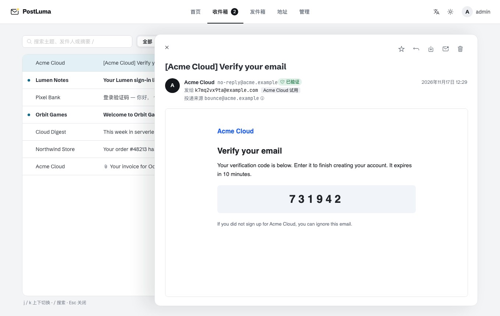
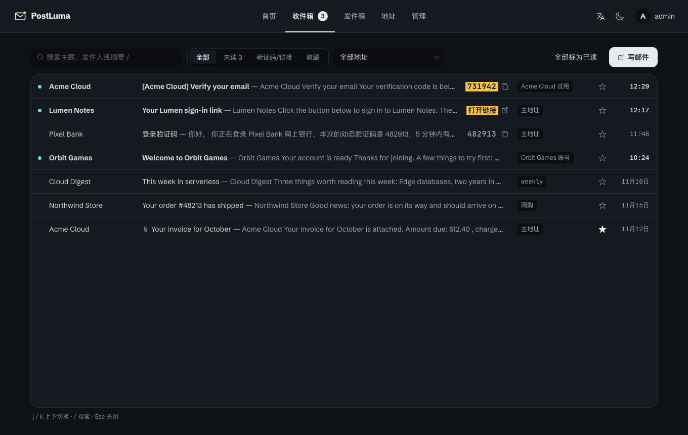
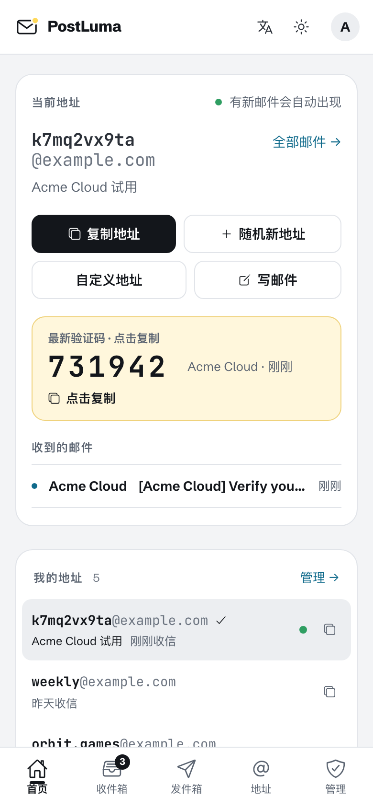

<p align="center">
  
</p>

<h1 align="center">PostLuma</h1>

<p align="center">
  跑在 Cloudflare 上的邮箱，不用服务器，免费版就能用。<br>
  可以当自己的邮箱，也可以给几个朋友当临时邮箱。
</p>

<p align="center">
  <a href="https://deploy.workers.cloudflare.com/?url=https://github.com/ZeyuZuo/postluma"></a>
</p>

<p align="center"><b>简体中文</b> · <a href="README.en.md">English</a></p>

| 首页：当前地址、最新验证码和所有地址 | 收件箱：点开的邮件从右边滑出 |
|---|---|
|  |  |
| **暗色主题** | **手机** |
|  |  |

## 为什么做

我想要一个能长期用的邮箱，平时主要拿来注册网站、收验证码，偶尔回几封信。但我不想为它维护一台服务器，系统补丁、nginx、证书，哪样都得有人盯着。

Cloudflare 的 Email Routing 能收信，Workers 能跑代码，D1 能存数据，一个人用的话免费额度足够。PostLuma 就是用这几样搭起来的邮箱，我自己的邮箱就跑在它上面。

## 用起来是什么样

在首页点“随机新地址”，地址马上生成，并且已经复制到剪贴板。拿它去网站注册，验证邮件一到就出现在地址下面，验证码用黄色标出来，点一下就复制。整个过程不用切页面，也不用刷新。

部署时用 `SERVICE_MODE` 选一种模式：

| | 个人邮箱 `personal` | 临时邮箱 `temporary` |
|---|---|---|
| 谁能用 | 只有管理员，也就是你 | 注册后由管理员审核的多个用户 |
| 注册和用户管理 | 没有 | 有，注册可以关闭 |
| 地址 | 不限数量，可以用 `me@`、`contact@` 这样的地址 | 有配额，3 到 32 位，不能用保留前缀 |
| 收藏邮件，不被自动清理 | 有 | 没有 |
| catch-all：发到新地址的第一封信自动建好这个地址 | 有，按域名开关 | 没有 |
| 发信 | 有，默认关闭 | 没有 |
| 随机地址、验证码、验证链接、自动清理、R2 存原件 | 有 | 有 |

## 功能

收信
- 随机地址或自定义地址，建好后自动复制，并成为首页的“当前地址”
- 新邮件不用刷新就会出现：新建地址后的 10 分钟内每 10 秒检查一次，其余时间每 30 秒
- 识别验证码，支持中、英、日关键词，会排除年份、金额、电话、订单号这类数字，点一下复制
- 识别“验证邮箱”“登录”这类链接，只认 https，点一下在新标签页打开
- 每个地址可以单独开启 `+别名`，发到 `name+shop@` 的信也会进 `name@`
- 支持多个收信域名

阅读
- HTML 邮件在不能运行脚本的沙箱里显示，远程图片默认不加载，要看时点“加载图片”
- 原始邮件存进 R2，可以下载附件、显示内嵌图片、看完整正文、下载 `.eml`
- 收件箱可以按未读、验证码和链接筛选，也可以按地址筛选、搜索，用 `j` / `k` 上下切换
- 发件人认证提示：按 Cloudflare 收信时的 SPF、DKIM、DMARC 结果，标出“已验证”或“发件人可疑”

个人邮箱模式
- 收藏的邮件连同 R2 里的原件不会被自动清理，最多 500 封
- catch-all：给某个域名打开后，发到新地址的第一封信会自动建好这个地址，并标上“自动创建”。每天最多自动建 10 个地址；自动建的地址合计最多用掉全站每日收信额度的一半，垃圾邮件再多，正常邮件也还有额度
- 发信默认关闭。打开后可以用自己的地址写信和回复，只发纯文本，通过 Resend 发送，每人每天 20 封，全站每天 100 封

临时邮箱模式
- 开放注册，管理员审核后才能用；可以封禁、解封，也可以关掉注册
- 每个用户有地址配额、地址总数上限和每日新建上限

管理和界面
- 管理收信域名，并检查 MX 记录是否指向 Cloudflare Email Routing
- 系统设置、使用统计、操作记录
- 邮件默认保留 30 天，到期自动删除
- 桌面用顶部导航，手机用底部标签栏；亮色和暗色主题；简体中文和 English

## 和同类项目的区别

Cloudflare 上已经有两个成熟的同类项目：[cloud-mail](https://github.com/maillab/cloud-mail) 和 [cloudflare_temp_email](https://github.com/dreamhunter2333/cloudflare_temp_email)。它们的功能比 PostLuma 多，比如 Telegram 推送、群发、第三方登录、用 Workers AI 识别验证码。需要这些的话，选它们更合适。

PostLuma 做的事少一些，换来这几点：

- 按免费版的额度来设计。每封信大约 7 次数据库写入，收信每天最多 5000 封，删除也有每日上限，两者加起来用不完 D1 每天 10 万次的免费写入额度。
- 用户之间的隔离写进了每一条查询，每个接口都有“用户 B 读写用户 A 的数据”的测试。一个地址分出去以后，永远不会再分给别人。
- 验证码和验证链接按规则识别，不调用 AI，也不依赖别的服务。

## 怎么工作的

```
                    ┌─────────────────────── 一个 Worker ───────────────────────┐
 浏览器 ──HTTPS──▶  │ 静态资源（Vue SPA）                                        │
                    │ fetch     → Hono API  /api/*   ──▶ D1（用户、地址、邮件）  │
 发件方 ──SMTP──▶   │ email     → 收信流水线           ──▶ R2（原始 .eml，可选） │
 Email Routing      │ scheduled → 定时清理（保留期、过期会话）                   │
                    └────────────────────────────────────────────────────────────┘
```

- 免费版每次调用只有 10 ms CPU，所以收信时只解析邮件的前 256 KB，结果写进 D1，用来列表、搜索和识别验证码。完整的原件同时流式写入 R2，附件由浏览器打开时再解析，Worker 不解码附件。
- 按请求或轮询执行的查询都走索引，有查询计划的回归测试兜着。具体额度以 Cloudflare 当前的文档为准。

## 部署

开始之前，你需要：

- 一个 Cloudflare 账号，和一个托管在 Cloudflare 上的域名。Email Routing 只支持这样的域名。
- 开通 R2。R2 要先绑定付款方式才能用，免费额度内（每月 10 GB 存储）不收费。不想开通的话，看后面的手动部署。

### 1. 创建 Turnstile 组件

登录页用 Turnstile 防止暴力破解。在 Cloudflare 控制台打开 Turnstile，添加一个组件：

- 主机名填你访问 PostLuma 时用的域名。用 `workers.dev` 访问就填 `<你的子域>.workers.dev`，子域在 Workers 概览页能看到。一个主机名会覆盖它下面的所有子域。以后绑定自定义域名，再把那个域名加进来。
- 建好后记下 Site Key 和 Secret Key。

### 2. 点按钮部署

[](https://deploy.workers.cloudflare.com/?url=https://github.com/ZeyuZuo/postluma)

Cloudflare 会把这个仓库复制到你的 GitHub 账号，建好 D1 数据库和 R2 存储桶，然后请你填三个值，三个都要填：

| 名称 | 填什么 |
|---|---|
| `ADMIN_INITIAL_PASSWORD` | 管理员 `admin` 的初始密码，只在第一次登录时用到 |
| `TURNSTILE_SITE_KEY` | 第 1 步的 Site Key |
| `TURNSTILE_SECRET_KEY` | 第 1 步的 Secret Key |

之后它会构建、建好数据库表并部署。以后你往自己那份仓库推送代码，都会自动重新部署。

### 3. 接通收信

在控制台打开你的域名，进入 Email → Email Routing，按提示启用，它会自动添加 MX 记录。然后在 Routing rules 里把 Catch-all 的动作设为 Send to a Worker，选择 `postluma`。

Catch-all 只负责把信转给 PostLuma，收不收由 PostLuma 决定：不存在或已停用的地址会被退信。

### 4. 第一次登录

打开 Worker 的地址，比如 `https://postluma.<你的子域>.workers.dev`。用户名是 `admin`，密码是第 2 步填的 `ADMIN_INITIAL_PASSWORD`。

登录后：

1. 点右上角头像，进入“账户设置”，把密码改掉。
2. 回到 Cloudflare 控制台，在这个 Worker 的 Settings → Variables and Secrets 里删除 `ADMIN_INITIAL_PASSWORD`。管理员只会初始化一次，以后用不到它。
3. 在“管理 → 收信域名”里添加第 3 步的域名。

现在就可以收信了。

### 个人邮箱还是临时邮箱

按钮部署出来的是个人邮箱模式，只有管理员能登录。想让别人注册使用，把你那份仓库里 `wrangler.jsonc` 的 `SERVICE_MODE` 改成 `temporary`，提交并推送。切换模式不会改动数据，随时可以改回来。

### 更新

按钮复制出来的仓库是一份独立的副本，不是 fork，不会跟着这里更新。要更新，就把这里的 main 合并进去：

```bash
git remote add upstream https://github.com/ZeyuZuo/postluma.git
```

```bash
git pull upstream main --allow-unrelated-histories
```

副本和这里可能没有共同的提交历史，所以第一次合并要加这个参数。有冲突时，保留你自己 `wrangler.jsonc` 里的 `database_id` 和改过的变量，然后推送。Cloudflare 会自动部署，新的数据库迁移也会一起执行。

打算一直跟着更新的话，也可以先 fork 这个仓库，再按下面的手动部署，在控制台里接入你的 fork。以后在 GitHub 上点 Sync fork 就能更新。

<details>
<summary>不用按钮，手动部署</summary>

需要 Node.js `^22.18` 或 `>=24.12`。

1. 获取代码：

   ```bash
   git clone https://github.com/ZeyuZuo/postluma.git && cd postluma && npm install
   ```

2. 在 `wrangler.jsonc` 里选择 `SERVICE_MODE`。
3. 创建 D1 数据库，把输出的 `database_id` 填进 `wrangler.jsonc`，替换里面现有的值：

   ```bash
   npx wrangler d1 create postluma
   ```

4. 创建 R2 存储桶。不想开通 R2，就删掉 `wrangler.jsonc` 里的 `r2_buckets` 一段，这样只保存解析后的内容，没有附件下载、内嵌图片和完整原件。

   ```bash
   npx wrangler r2 bucket create postluma-mail
   ```

5. 按上面第 1 步创建 Turnstile 组件。
6. 部署，然后设置三个密钥：

   ```bash
   npm run deploy
   ```

   ```bash
   npx wrangler secret put ADMIN_INITIAL_PASSWORD
   ```

   ```bash
   npx wrangler secret put TURNSTILE_SITE_KEY
   ```

   ```bash
   npx wrangler secret put TURNSTILE_SECRET_KEY
   ```

   也可以在控制台用 Workers & Pages → Create → Import a repository 接入仓库：Build command 填 `npm run build`，Deploy command 填 `npx wrangler d1 migrations apply DB --remote && npx wrangler deploy`，之后每次推送都会自动部署。

7. 按上面的第 3、4 步接通收信并登录。

旧版本用构建变量 `VITE_TURNSTILE_SITE_KEY` 提供 Site Key，现在仍然有效；设置了 `TURNSTILE_SITE_KEY` 时以它为准。

</details>

<details>
<summary>开启发信（个人邮箱模式）</summary>

1. 在 [Resend](https://resend.com) 添加并验证你的发信域名。按提示在 Cloudflare DNS 里加 DKIM 和 SPF 记录，通常放在 `send.` 子域下，不影响收信用的 MX。
2. 在 Resend 创建 API Key，然后执行 `npx wrangler secret put RESEND_API_KEY`，或者在 Worker 的 Variables and Secrets 里添加。
3. 在 PostLuma 的“管理 → 系统设置 → 发信”里打开“允许发信（总开关）”，发一封测试信；再到“收信域名”里给要用的域名打开“可发信”。

每封最多 5 个收件人，每人每天 20 封，全站每天 100 封，正好是 Resend 免费版的每日上限。

</details>

catch-all 不需要额外配置：在“管理 → 收信域名”里给域名打开“catch-all 自动建地址”即可，每天能自动建几个地址、每个地址每小时能收几封，在系统设置里调整。

## 配置

可调参数都在 `wrangler.jsonc` 的 `vars` 里，每项都有注释和允许范围，超出范围会回退到默认值，并在日志里给出警告。改完提交推送就会生效。不要在 Cloudflare 控制台里改这些变量，下次部署时会被文件里的值覆盖。

<details>
<summary>参数列表</summary>

| 变量 | 仓库里的值 | 说明 |
|---|---|---|
| `SERVICE_MODE` | `personal` | `personal` 或 `temporary`；不填或填错时按 `temporary` 处理 |
| `REGISTRATION_OPEN` | `true` | 临时邮箱模式是否开放注册，管理员可在后台覆盖 |
| `DEFAULT_MAILBOX_QUOTA` | `10` | 临时邮箱模式下每个用户同时使用的地址数，可以按用户调整 |
| `MAX_TOTAL_MAILBOXES` / `MAX_DAILY_MAILBOX_CREATIONS` | `100` / `30` | 地址总数（含已停用）和 24 小时内的新建上限 |
| `INGEST_MAX_PER_MAILBOX_PER_HOUR` / `INGEST_MAX_PER_USER_PER_HOUR` | `10` / `100` | 防刷信限流，管理员不受限 |
| `INGEST_MAX_MESSAGES_PER_DAY` / `INGEST_MAX_MB_PER_DAY` | `5000` / `12` | 全站每天的收信额度 |
| `RAW_MAIL_MAX_MB_PER_DAY` | `250` | 每天写入 R2 的原始邮件上限，`0` 表示不保存原件 |
| `MESSAGE_RETENTION_DAYS` | `30` | 邮件保留天数，管理员可覆盖，受数据库容量限制 |
| `MAX_DELETES_PER_DAY` | `5000` | 定时清理和批量删除共用的每日上限 |
| `MAX_STARRED_MESSAGES` | `500` | 每人最多收藏几封 |
| `CATCH_ALL_MAX_PER_DAY` / `CATCH_ALL_MAX_PER_ADDRESS_PER_HOUR` | `10` / `10` | catch-all 每天最多自动建几个地址、每个自动建的地址每小时最多收几封，都可以在后台覆盖 |
| `SENDER_AUTH_HINTS` | `true` | 显示发件人认证结果 |
| `PASSWORD_PBKDF2_ITERATIONS` | `20000` | 免费版 CPU 限制下的取舍，升级付费版后可以调高 |
| `SENDING_ENABLED` | `false` | 发信总开关的默认值，管理员可在后台覆盖 |
| `MAIL_PROVIDER` | `resend` | 发信服务商；`log` 只记录不发送，用于本地开发 |
| `SEND_MAX_PER_USER_PER_DAY` / `SEND_MAX_PER_DAY` | `20` / `100` | 每人和全站 24 小时内的发信上限 |
| `SEND_MAX_RECIPIENTS` | `5` | 每封邮件的收件人上限 |

</details>

## 安全

- 用户之间的数据隔离：所有地址和邮件查询都在 SQL 里带上 `user_id`，访问别人的资源返回 404，和不存在一样，没法通过 ID 探测。每个接口都有跨用户测试。
- 收信只认信封收件人：一封信归谁，只看收件地址精确匹配到的那条地址记录，不看任何邮件头，也不做模糊匹配。
- 地址永不复用：地址只能停用，不能删除；删除用户时，他的地址会进入永久保留表，新用户收不到前一位的验证码和重置密码邮件。
- 管理员看不到邮件：管理接口只返回统计数字，不返回邮件内容，也不返回用户的地址。
- 登录：PBKDF2 密码哈希，HttpOnly Cookie 加数据库会话，可以随时作废；登录和注册有 Turnstile 和按 IP 限流；写请求要校验同源的 `Origin`。
- 附件一律以 `application/octet-stream` 下载，邮件内容不会在本站域名下渲染。

## 不做什么

- 不是完整的邮件客户端：没有文件夹、IMAP/SMTP、通讯录、HTML 写信和附件发送。
- 临时邮箱模式不发信，避免域名被拿去滥发，影响收信。
- 不删除地址。停用的地址仍然能看历史邮件，也可以重新启用，旧邮件按保留期清理。
- 管理员不能查看用户的邮件。这是有意的设计，不是待办事项。

## 常见问题

- **登录按钮点不了，或者提示人机验证失败**：检查 `TURNSTILE_SITE_KEY` 和 `TURNSTILE_SECRET_KEY` 是不是同一个组件的，有没有填反，组件的主机名里有没有你访问用的域名（主机名不对时 Turnstile 报错 110200）。
- **部署时提示 Please enable R2 through the Cloudflare Dashboard**：账号还没开通 R2。开通后重新部署，或者改用手动部署并删掉 `r2_buckets`。
- **发到某个地址的信被退回**：确认地址处于“使用中”、域名的 Catch-all 指向了 `postluma`；临时邮箱模式下还要确认这个用户已通过审核。
- **登录时报错 1102**：Worker 超出了免费版的 CPU 时间，调低 `PASSWORD_PBKDF2_ITERATIONS`。

## 本地开发

```bash
cp .dev.vars.local.example .dev.vars    # 本地用的密钥，默认关闭 Turnstile
npm run db:migrate:local                # 初始化本地 D1
npm run dev                             # 前端、API 和收信在同一个服务里
```

模拟收信，`+` 要写成 `%2B`：

```bash
curl -X POST --data-binary @mail.eml "http://localhost:5173/cdn-cgi/handler/email?from=a@example.org&to=name@your.domain"
```

测试：

```bash
npm test             # Vitest，跑在 workerd 里：接口、收信、跨用户隔离、查询计划
npm run test:e2e     # Playwright：HTML 邮件的安全渲染、主要操作流程、手机宽度的布局
npm run type-check
```

浏览器测试会分别启动个人邮箱和临时邮箱两个开发服务器，各用一份临时数据，不影响本地开发数据。第一次运行前先执行 `npx playwright install chromium`。

`npm install` 提示 workerd 或 esbuild 的安装脚本被阻止时（npm 12 默认阻止），执行 `npm install-scripts approve workerd esbuild && npm rebuild workerd esbuild`。本地查询报 `no such table` 时，重新执行 `npm run db:migrate:local`。

目录：`worker/` 是 Worker，包括 API、收信、定时任务和全部 SQL；`src/` 是 Vue 前端；`shared/` 是前后端共用的类型和校验；`migrations/` 是数据库迁移；`test/` 和 `e2e/` 是测试。开发约定见 [CLAUDE.md](CLAUDE.md)，需求和决策记录在 [docs/](docs/)。

## 许可证

Copyright (C) 2026 Zeyu Zuo

PostLuma 是开源软件，采用 [GNU AGPL-3.0](LICENSE)：

- 任何人都可以免费使用、部署、修改和分享，包括用于商业用途。
- 分发修改后的版本时，必须同样采用 AGPL-3.0，并向拿到它的人提供完整源码。
- 把修改后的版本部署成网站或服务时，也要向使用它的人提供源码。

软件按原样提供，不含任何担保。第三方依赖和字体遵循各自的许可证。
